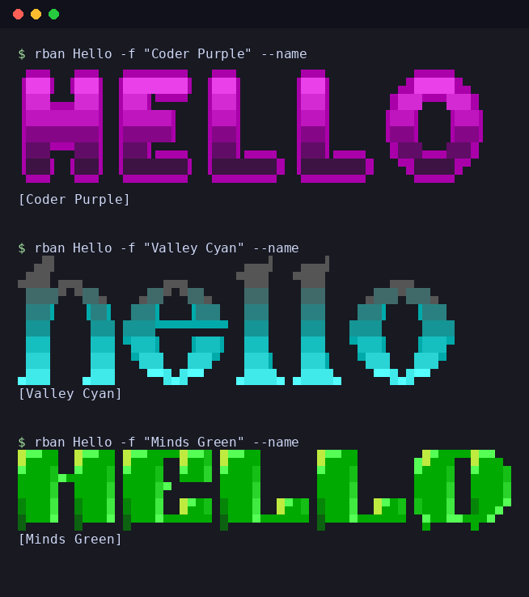
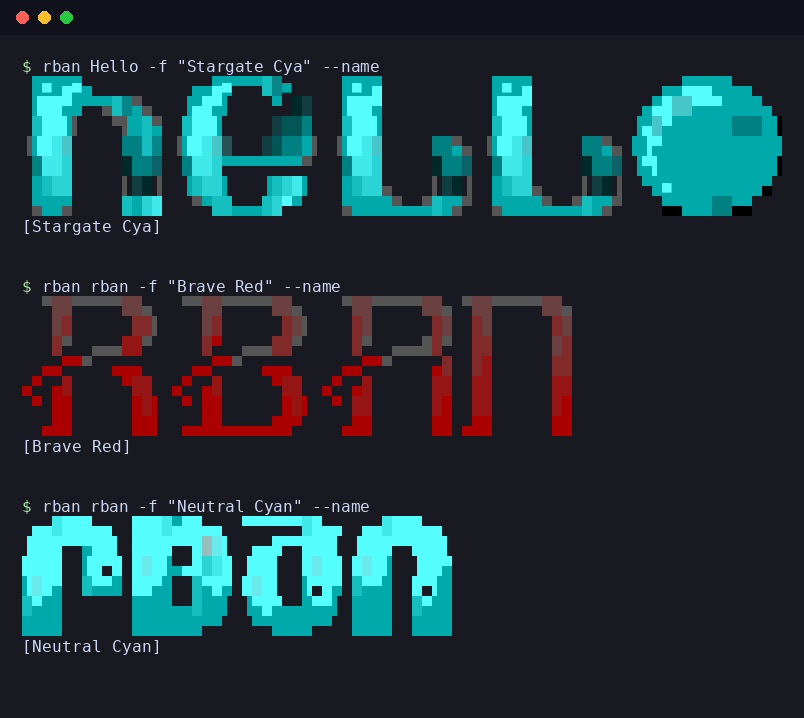
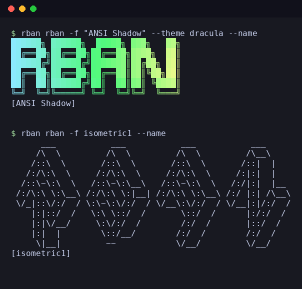
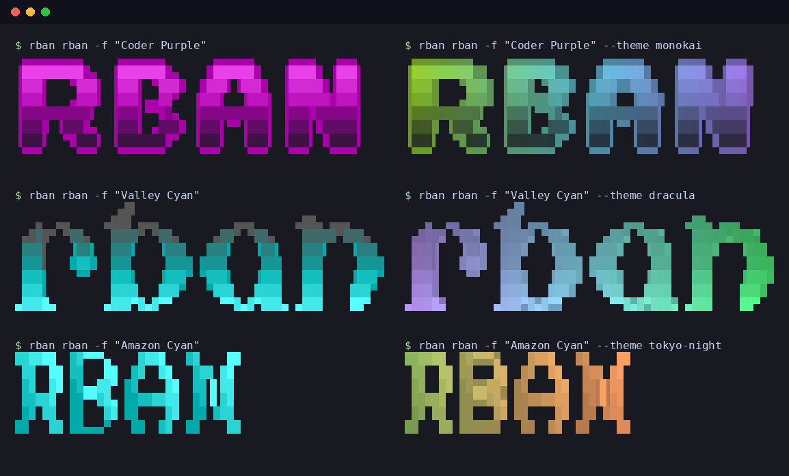
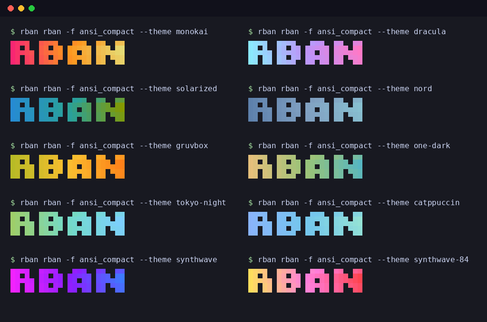

# rban

Turn text into ASCII/ANSI art right in your terminal, with **3,800+ fonts bundled**, including thousands of
colored TheDraw fonts. No Python, no dependencies, one self-contained binary.

**The original idea comes from [TAAG (Text to ASCII Art Generator)](https://patorjk.com/software/taag/), by Pat (patorjk).**
rban is a command-line take on it, written in Rust. All the credit for the idea, and for gathering these fonts, goes to him.

rban is a rewrite of [banna](https://github.com/s-brue/banna), built for two reasons: speed (startup goes from ~40 ms
in Python to ~2 ms) and self-containment (all 3,800+ fonts are compiled into a single binary — no Python, no venv,
no separate font files).

## Features

- **386 FIGlet fonts** and **3,481 colored TheDraw fonts**, all bundled inside the binary. Fully offline.
- **Random font by default** — every run uses a different font, with no repeats until the whole group has come up.
- Color gradients with classic themes (Monokai, Dracula, Solarized, Nord, Gruvbox, One Dark, Tokyo Night,
  Catppuccin, Synthwave) on **any** font; TheDraw fonts keep their shading.
- Pick your own rotation: `fonts.conf` lists every font; comment out the ones you don't like.
- Single static binary (~3.5 MB on Linux). No runtime dependencies.
- One-line install for your user (`curl | bash`, no `sudo`), for Linux and macOS on x86_64 and aarch64.

## Quick install

On Linux and macOS, for your user only (no `sudo`):

    curl -fsSL https://raw.githubusercontent.com/s-brue/rban/main/install.sh | bash

Then just run `rban "Hello"` — a different font every time.

What the installer does:

- Detects your OS and architecture (Linux/macOS × x86\_64/aarch64).
- Downloads the right pre-built binary from GitHub Releases into `~/.local/bin/rban`.
- If `~/.local/bin` is not in your `PATH` it tells you how to add it; it does not edit your shell files.
- Never touches your settings (`~/.config/rban`) or the rotation history (`~/.cache/rban.json`).

To update, run the same command again. To uninstall:

    curl -fsSL https://raw.githubusercontent.com/s-brue/rban/main/install.sh | bash -s -- --uninstall

Piping a script into a shell runs whatever is served, so you may prefer to read [install.sh](install.sh) first (it is
short) or to pin a release:

    curl -fsSL https://raw.githubusercontent.com/s-brue/rban/main/install.sh | RBAN_REF=v0.1.0 bash

`RBAN_PREFIX` overrides the install location (default: `~/.local`).

## Usage

    rban "Hello"                                        # random font (default)
    rban "Hello" -f "Stargate Cya"                      # a specific font (FIGlet or TheDraw)
    rban "Hello" --all                                  # every font in fonts.conf
    rban "Hello" --ansi-only                            # random, only colored TheDraw fonts
    rban "Hello" --ascii-only                           # random, only FIGlet (ASCII) fonts
    rban "Hello" -f "ANSI Shadow"                       # block-style fonts get a gradient automatically
    rban "Hello" -f "ANSI Shadow" --theme monokai       # ...in a theme of your choice
    rban "Hello" -f doom --gradient                     # a gradient on ANY font, even plain FIGlet
    rban "Hello" -f "Stargate Cya" --theme nord         # recolor a TheDraw font with a theme
    rban "Hello" --name                                 # print [font name] after the banner
    rban "Hello" --all-pager                            # all fonts, streamed to a color pager
    rban --list-figlet                                  # list font names (also: --list-ansi, --list-themes)

Font names ignore case, spaces, hyphens and underscores: `-f "ANSI Shadow"` and `-f ansi_shadow` are the same.

| Option | What it does |
|---|---|
| `-f`, `--font NAME` | Use a specific font. Any of the 3,800+ bundled fonts works. |
| `--all` | Every font in the active rotation. |
| `--all-pager` | Same as `--all`, but streams output to a color-aware pager (`less -R`). Forces color on. |
| `--ansi-only` | Restrict the random pick or `--all` to colored TheDraw fonts. |
| `--ascii-only` | Restrict the random pick or `--all` to FIGlet fonts. Not combinable with `--ansi-only`. |
| `--theme NAME` | Gradient colors: `monokai`, `dracula`, `solarized`, `nord`, `gruvbox`, `one-dark`, `tokyo-night`, `catppuccin`, `synthwave`, `synthwave-84`, or `random` (default). Implies `--gradient`. |
| `--gradient` | Paint **any** font with a theme gradient (random theme unless `--theme` is given). |
| `--name` | Print `[font name]` right after the banner. |
| `--color` / `--no-color` | Force or disable color. By default color is used only when writing to a terminal. `NO_COLOR` is honored. |
| `--truecolor` | Use exact CGA RGB colors for TheDraw fonts instead of the terminal's 16-color palette. |
| `--width N` | Maximum width for FIGlet fonts (default 120). |
| `--conf PATH` | Use an alternative `fonts.conf`. |
| `--list-figlet`, `--list-ansi`, `--list-themes` | List available fonts / themes and exit. |
| `--credits` | Print font credits and exit (uses pager when stdout is a TTY). |
| `--license` | Print the software license and dependency list, and exit. |
| `--version` | Print the version. |

Exit status: `0` on success, `1` if a font is not found.

### Gradients and themes

There are three ways to get a gradient (requires color output):

1. **Automatically**, for the block-style fonts in the `[gradient]` section of `fonts.conf` (`ANSI Shadow`,
   `ANSI Regular`, `Bloody`, `Elite`...):

       rban "Hello" -f "ANSI Shadow"
       rban "Hello" -f "ANSI Shadow" --theme monokai

2. **On any plain FIGlet font** with `--gradient`:

       rban "Hello" -f doom --gradient --theme dracula

3. **On colored TheDraw fonts**, replacing their colors with the theme while **keeping their shading**:

       rban "Hello" -f "Coder Purple" --theme monokai
       rban "Hello" --ansi-only --gradient

   

Passing `--theme` always enables the gradient, for any font. `rban --list-themes` shows the ten themes.
Each gradient uses three consecutive accent colors of the theme starting at a random point of its palette,
so the same theme gives a slightly different, always on-palette, result on each run.

## Configuration: fonts.conf

`fonts.conf` controls the rotation used by the random pick and `--all`. Sections: `[fonts]` (plain FIGlet),
`[gradient]` (block-style FIGlet that always gets a gradient), and `[ansi]` (colored TheDraw; a single `*`
means all of them). Put `#` in front of any font you don't want. `-f` ignores the list and works with any
bundled font.

rban looks for the config in this order:

1. `--conf PATH`
2. `~/.config/rban/fonts.conf` (`$XDG_CONFIG_HOME` is honored)
3. `/etc/rban/fonts.conf`
4. the bundled one (compiled into the binary)

To customize it, copy the bundled `fonts.conf` from the [repository](fonts.conf) to
`~/.config/rban/fonts.conf` and edit it. The rotation history is in `~/.cache/rban.json`
(`$XDG_CACHE_HOME` is honored; delete it to reset).

> **Note:** TAAG has 643 FIGlet fonts, but 257 of them do not read well (misaligned fonts, Commodore 64
> fonts with broken lowercase, symbolic or broken ones), so they are not included in the rotation.

## Project layout

    src/main.rs      CLI, font groups, rendering dispatch
    src/tdf.rs       reader/renderer for TheDraw (.tdf) fonts
    src/themes.rs    gradient color themes
    src/assets.rs    rust-embed wrappers for the bundled font data
    install.sh       per-user installer (curl | bash)
    fonts.conf       fonts in the default rotation
    ascii/           FIGlet fonts (.flf, .tlf) — bundled into the binary at compile time
    ansi/            TheDraw fonts (.tdf) and index.json — bundled into the binary at compile time
    .github/         GitHub Actions release workflow (builds 4 targets, applies UPX on Linux)

## Development

    cargo build                  # debug build
    cargo build --release        # release build (~32 MB before UPX)
    cargo run -- "Hello"         # run from checkout
    cargo test                   # run tests

The release binary embeds all fonts via [rust-embed](https://github.com/pyros2097/rust-embed).
Applying `upx --lzma` brings it from ~32 MB to ~3.5 MB on Linux.
The GitHub Actions workflow does this automatically for every release tag.

## Credits

Every font was made by someone else. [CREDITS.md](CREDITS.md) lists the authorship as far as it is known,
and where each font category comes from. The credits are also compiled into the binary: `rban --credits`.

## License

rban's code and documentation are under the [MIT License](LICENSE). **The bundled fonts are not.** To be plain about it:

- The fonts belong to their authors. They were copied from [TAAG](https://patorjk.com/software/taag/) and
  from the pyfiglet package, which distribute them publicly, without checking each font's individual terms.
- Many have no license: of the 386 FIGlet fonts, 280 have headers that say nothing about copyright or
  license, and the 3,481 TheDraw fonts carry no author or license information at all.
- **Do not assume the fonts are free for any use.** If you use them commercially, modify them, or
  redistribute them, check each font's terms or ask its author.
- If you made a font, or hold its rights, and you want it credited differently or removed, open an issue
  or write to brue@gmx.com. It will be removed as soon as possible.
